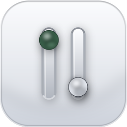

# Topiary: macOS 菜单栏管理器

<p align="center">
  
</p>

<p align="center">
  <strong>彻底掌控你的 macOS 菜单栏。</strong><br>
  看清、唤起、退出、常驻 Mac 上运行着的每一个菜单栏应用与后台常驻进程。
</p>

<p align="center">
  <a href="https://sky-jiangcheng.github.io/topiary-bar/"><strong>官方网站</strong></a> ·
  <a href="https://github.com/sky-jiangcheng/topiary-bar/releases/latest"><strong>下载 DMG</strong></a> ·
  <a href="#-快速开始"><strong>快速开始</strong></a> ·
  <a href="README.md"><strong>English</strong></a>
</p>

<p align="center">
  <a href="https://github.com/sky-jiangcheng/topiary-bar/releases"></a>
  <a href="https://github.com/sky-jiangcheng/topiary-bar/actions/workflows/test.yml"></a>
  <a href="LICENSE"></a>
  <a href="https://swift.org"></a>
  <a href="https://www.apple.com/macos/"></a>
  <a href="https://sky-jiangcheng.github.io/topiary-bar/privacy/"></a>
</p>

---

## 💡 为什么选择 Topiary？

现代 macOS 菜单栏极易陷入拥挤与失控：后台同步工具、辅助插件常常被屏幕刘海吞没；由于没有标准交互窗口，你很难一览它们占用了多少内存，更无法便捷地退出或唤醒。

**Topiary 为此量身打造：**
- 🛡️ **0 权限索取，0 数据上传**：无需辅助功能权限，无埋点无网络请求，所有逻辑 100% 本地运行。
- 📌 **独立常驻图钉**：勾选关键应用，直接在系统菜单栏生成独立常驻项，左键唤醒、右键管理。
- 🛟 **刘海遮挡自愈**：当系统图标被 MacBook 刘海遮挡时自动感应并弹窗提醒，后台代理永不失联。
- ⚡ **原生轻量**：基于 Swift 6 + SwiftUI / AppKit 打造，内存与性能开销极低。

---

## ✨ 特性一览

### 📌 菜单栏独立常驻
* **无缝图钉化**：将你常用的菜单栏应用固定在系统顶栏，即使原应用没有便捷入口，也能一键呼出前台。
* **常驻状态持久化**：图标顺序与勾选状态跨开机和应用重启始终生效。

### 🚦 智能应用管理
* **自动识别分类**：智能检测并区分纯状态栏常驻应用（`activationPolicy == .accessory`）与普通 Dock 应用。
* **Accessory 可靠唤起**：针对系统通常拒绝直接 `activate()` 的 accessory 插件，通过 `openApplication(at:configuration:)` 实现精准唤醒。
* **安全退出与强杀保护**：支持优雅平滑退出，并在异常未响应时升级为强制终止（开发者公证版本支持）。
* **毫秒级极速检索**：主窗口与快捷浮窗均支持按名称、Bundle ID 实时过滤定位。

### 🎨 贴近原生的 macOS 质感
* **双模式界面**：轻量级顶栏 Popover 瞬时查阅 + 完整独立主窗口沉浸式管理。
* **直观内存监控**：一目了然的内存水饺条和单进程本地内存统计。
* **全局快捷键**：默认 <kbd>⌃</kbd> <kbd>⌥</kbd> <kbd>M</kbd> 随时唤起，无需移手操作鼠标。
* **丰富定制**：支持系统深浅外观、6 种风格菜单栏图标、内置中/英/日/德/西 5 国原生本地化语言。

---

## 🚀 快速开始

### 安装使用

#### 方式一：直接下载（推荐）
1. 从 [GitHub Releases](https://github.com/sky-jiangcheng/topiary-bar/releases/latest) 下载最新的 `Topiary-<version>.dmg`。
2. 双击打开并将 **Topiary.app** 拖入 **Applications** 应用程序文件夹。
3. 启动应用。（*经 Apple Developer ID 官方签名公证，包含完整退出与唤起功能*）。

#### 方式二：Mac App Store
也可前往 Mac App Store 搜索下载（根据苹果应用商店沙盒安全机制，该版本去除了直接进程终止接口）。

---

## 🛠️ 从源码编译

### 环境准备
* macOS 14.0 或更高版本
* Xcode 16.0+（Swift 6.0 工具链）

```bash
# 克隆仓库
git clone https://github.com/sky-jiangcheng/topiary-bar.git
cd topiary-bar

# 本地编译、签名并直接运行
./script/build_and_run.sh

# 或者仅使用 Swift PM 编译
swift build
```

---

## 🔐 隐私与安全承诺

Topiary 坚持以隐私保护为核心底线：
* **无联网权限**：未配置任何网络通信权限，代码绝不发起任何外部请求。
* **无遥测上报**：绝不搜集任何使用习惯、统计指标或硬件标识。
* **公开原生 API**：所有信息均通过公开的系统接口获取，无需开启辅助功能（Accessibility）或完全磁盘访问权限。
* 内置符合苹果规范的隐私清单文件（`PrivacyInfo.xcprivacy`）。

欢迎查阅完整的[隐私政策](https://sky-jiangcheng.github.io/topiary-bar/privacy/)。

---

## 🤝 参与贡献与社区传播

我们非常欢迎社区以各种形式参与：
- 🌟 如果这个项目对你有帮助，欢迎在 GitHub 上点一个 **Star** 让更多人看到！
- 🐛 遇到 Bug 或有好的 Idea？欢迎提交 [Issue](https://github.com/sky-jiangcheng/topiary-bar/issues) 或发起 [Pull Request](https://github.com/sky-jiangcheng/topiary-bar/pulls)。
- 📣 欢迎在社交平台（X / 即刻 / 掘金 / V2EX / Reddit）分享你使用 Topiary 的体验。

---

## 📄 开源许可证与商用授权

本项目采用宽松友好的 **[MIT 许可证](LICENSE)** 开源。

```text
Copyright (c) 2026 sky-jiangcheng

Permission is hereby granted, free of charge, to any person obtaining a copy
of this software and associated documentation files (the "Software"), to deal
in the Software without restriction, including without limitation the rights
to use, copy, modify, merge, publish, distribute, sublicense, and/or sell
copies of the Software...
```

### 许可证核心解读：
- ✅ **完全免费**：无论是个人学习、个人日常使用还是商业机构内部使用，均完全免费。
- ✅ **允许二次开发与商用分发**：你可以自由 Fork、重构、打包或将其整合到你的私有/开源产品中。
- ℹ️ **版权与免责声明**：在二次分发时只需保留原作者的版权声明与许可正文。
- 🛡️ **无担保免责**：软件按“原样”提供，作者不承担使用造成的连带保证责任。

完整许可条款详见 [`LICENSE`](LICENSE) 文件。

---

<p align="center">
  用心打造每一个像素 · <a href="https://sky-jiangcheng.github.io/topiary-bar/">访问官方网站</a>
</p>
