# 界面与代码审查报告（Topiary）

> **来源与用途**：本报告由外部评审会话以附件形式提供（原文件位于
> `.zwork/attachments/`，属会话暂存目录、被 `.zwork/.gitignore` 全量忽略，换会话即丢失）。
> 迁入 `design/` 是为了让这一轮品牌与 UI 重做的**输入**与产物一起留在仓库里，可追溯。
>
> **阅读前提**：报告描述的是重做**之前**的状态（例如它指出 `Theme` 只有三个圆角
> token、行内按钮常驻可见——两点都已在在途改动里改掉）。逐条处置结果见
> [`design/README.md`](../README.md) 的对照表，不要按现状理解文中的行号。

---

# Topiary Bar — 挑剔审查报告

> [!NOTE]
> 本报告涵盖**界面审美、交互设计、代码结构**三个维度，重点指出问题，并附具体升级建议。

---

## 一、总体印象

Topiary 整体骨架健康：SwiftUI `@Observable` 架构清晰、设计 token 已抽离进 `Theme`、多语言体系完整、代码注释密度优秀。
但在**视觉精致度、空间节奏、信息层级**上存在若干值得打磨的地方，具体如下。

---

## 二、界面审美 — 逐点挑剔

### 2.1 Popover — 信息密度失衡

**问题：** `PopoverView` 高度范围 420–520 pt，内容分为五段（header / memory / search / list / footer），但各段高度分配缺乏弹性，footer 的三个按钮挤在同一行，视觉权重混乱。

| 现状 | 问题 |
|------|------|
| Header 图标 16×16 pt | 在 Retina 下显示清晰，但和 Logo 文字对比时太小，品牌感弱 |
| Memory bar `.controlSize(.small)` | 进度条高度约 3 pt，对比文字内容太细，阅读时视线容易跳过 |
| footer 三按钮布局 | `Settings (gear)` 靠左 60pt、`Open Main Window (borderedProminent)` 居中、`Quit (bordered)` 靠右 60pt — 三种视觉重量（plain/prominent/bordered）混在一行，**层级混乱** |
| `occlusionBanner` 背景 `.orange.opacity(0.08)` | 极低对比度，浅色模式下几乎看不见橙色背景，警告感不足 |
| Search field `padding(.vertical, 8)` × 2 | 外层 `VStack` 和内层 `background` 各有一层 vertical padding，叠加后间距比 Header 还大，节奏错乱 |

**建议：**
- Header icon 改为 20×20，左右 icon 与文字用 `alignmentGuide` 精确对齐
- Memory `ProgressView` 改 `.medium` 或自绘 4–5 pt 高度圆角 bar
- Footer 重组：gear 与 quit 合并进右侧次级区域，`Open Main Window` 独立居中为主行动按钮
- occlusionBanner 背景改为 `.orange.opacity(0.15)`，并加 1 pt `.orange.opacity(0.4)` 描边

---

### 2.2 IconRow — 行高与按钮节奏

**问题：** [`IconRow`](file:///Users/jiangcheng/Workspace/Script/topiary-bar/Sources/topiary-bar/Views/PopoverView.swift#L297-L345) 每行 `.padding(.vertical, 7)` × 2 侧 = 行高约 40 pt。行内同时显示「进程名」+「内存」+「Open」+「Quit」四个元素，在应用名较长时会严重压缩内存数值和按钮。

```
[icon] [AppName (可能超长...)] [空格] [257 MB] [Open] [Quit]
```

- 两个 `.bordered` + `.mini` 按钮**始终可见**（非 hover 态），在正常使用场景下 Quit 是危险操作，暴露过于激进
- `Open` / `Quit` 按钮用 `.bordered` + `.mini`，按钮文字字号约 10 pt，点击热区偏小（macOS HIG 建议最小 22 pt）

**建议：**
- 按钮改为 hover 浮现（`@State private var isHovered`），平时只显示 icon+name+memory
- Quit 按钮加一层二次确认（`.confirmationDialog` 或 `.help` tooltip 写明后果）
- 或将 Quit 移出主列表，放入右键 context menu / 详情面板

---

### 2.3 主窗口 ContentView — 设计语言割裂

**问题：** 主窗口使用标准 macOS `List(.sidebar)` + `HSplitView`，而 Popover 使用完全自定义的 `ScrollView + LazyVStack`。两处视觉语言不一致：

- 侧栏行用 `.padding(.vertical, 6)` 无背景，Popover 行用 `.padding(.vertical, 7)` 带悬停色
- `sectionHeader` 在侧栏用 `Label(title, systemImage:)` 带图标，在 Popover 只用 `Text("title · N")`，风格不同

**建议：** 将 `IconRow`（Popover）与 `SidebarRow`（主窗口）的 data-only 部分提取为共享 `AppRowContent` 组件，两处各自包装布局层，保证品牌一致性。

---

### 2.4 OverviewView — 空间浪费，视觉重心不稳

**问题：** [`OverviewView`](file:///Users/jiangcheng/Workspace/Script/topiary-bar/Sources/topiary-bar/Views/ContentView.swift#L262-L403) 是未选中状态的占位屏，内容为 App 图标 → 标题 → 三个 StatChip → 警告块 → 常驻列表 → 提示文字，全部居中排列，整体占据 400+ pt 宽度的右侧面板。

- App 图标 56×56 pt + 标题，品牌展示意义不大，用户每次切换 app 都会看到
- `StatChip` 三枚横排使用 `Capsule()` 背景，风格偏 iOS，macOS 上显得过圆、过重
- `selectAppPrompt` 提示文字孤零零地飘在常驻列表下方，缺乏视觉锚点

**建议：**
- 将 StatChip 改为更克制的 macOS 风格：去掉 Capsule，改用分隔线 + 纯数字布局（参考 Activity Monitor 右上角统计栏）
- 图标 + 品牌名改为左上角小尺寸徽标（24 pt），右侧面板顶部居左，腾出空间给有效内容
- `selectAppPrompt` 整合到 StatChip 区域，变为副标题

---

### 2.5 SettingsView — 样式重复与信息噪音

**问题：** [`AggregationIconSelector`](file:///Users/jiangcheng/Workspace/Script/topiary-bar/Sources/topiary-bar/Views/AggregationIconSelector.swift) 在 SettingsView 中嵌套时，会**重复渲染**标题 `l10n.sectionAggIcon` 和说明 `l10n.aggIconCaption`——这两段文字在 `AggregationIconSelector.body` 里各出现一次，而 `SettingsView` 的 `Section(l10n.sectionAggIcon)` 已经提供了 Section header，外加 `Text(l10n.aggIconCaption)` 作为 Section 第一行，导致说明文字实际出现两次。

**建议：** `AggregationIconSelector` 去掉内部的 `Text(l10n.sectionAggIcon)` 和 `Text(l10n.aggIconCaption)`，仅保留 `LazyVGrid`；描述统一由 `SettingsView` 的 Section body 提供。

---

### 2.6 Theme.swift — 设计 Token 不完整

**问题：** [`Theme`](file:///Users/jiangcheng/Workspace/Script/topiary-bar/Sources/topiary-bar/Views/Theme.swift) 只有三个圆角半径，没有：

- 统一间距 token（各处 padding 用字面量 8/12/16/24 散落各文件）
- 字体 token（`.caption` / `.callout` / `.body` / `.headline` 硬编码在每个 View）
- 颜色语义 token（`warning orange`、`secondary background` 等颜色直接内嵌）

**建议：** 扩展 `Theme`：

```swift
enum Theme {
    enum Radius { … }       // ✅ 已有
    enum Spacing {          // ❌ 缺失
        static let xs: CGFloat = 4
        static let sm: CGFloat = 8
        static let md: CGFloat = 12
        static let lg: CGFloat = 16
        static let xl: CGFloat = 24
    }
    enum Color {            // ❌ 缺失
        static let warning = SwiftUI.Color.orange
        static let secondaryFill = SwiftUI.Color.secondary.opacity(0.1)
    }
}
```

---

### 2.7 官网 (docs/index.html) — 平平无奇

**问题：** 官网采用纯文本 + feature-grid 结构，没有任何截图、动图或 App 视觉展示，缺乏产品感。

- `feature-card` 背景仅 `rgba(128,128,128,0.1)`，无边框无阴影，视觉极其平淡
- h1 `font-size: 34px` 但没有 subtitle 副标题，品牌层级单薄
- 没有 Hero section、CTA 按钮、下载角标
- `badge-dock` 颜色 `rgb(34, 197, 94)` 纯绿偏深，深色模式下对比度可能不足
- Links 区域三行孤零零，没有分组和视觉层次

**建议（按优先级）：**
1. 加 macOS 风格的 App 截图（Frame 用 macOS 窗口样式），放在 Hero 区域
2. 下载按钮改为带 Apple logo 风格的 CTA 按钮
3. feature-card 加 `border: 1px solid rgba(128,128,128,0.2)` 区分卡片边界
4. 底部加 footer（版权、GitHub 链接集中）

---

## 三、交互与功能 — 挑剔清单

| # | 问题 | 严重程度 | 建议 |
|---|------|---------|------|
| 1 | Popover `IconRow` 的 Quit 按钮无确认 | 🔴 高 | 加 `.confirmationDialog` 或改为右键菜单项 |
| 2 | Popover 搜索框和主窗口侧栏搜索框是独立状态，搜索词不同步 | 🟡 中 | 可接受，但文档中应说明这是设计决策 |
| 3 | `HotKeyRecorderView` 使用 `NSView.draw()` 手绘，和系统 `NSSearchField` / `NSTokenField` 视觉差异较大 | 🟡 中 | 可改用 `NSTextField` 子类，保留 first-responder 逻辑 |
| 4 | `OverviewView.residentSection` 宽度硬编码 `.frame(width: 320)` | 🟡 中 | 改为 `maxWidth: 360` 让布局响应窗口缩放 |
| 5 | `ContentView.appsView` 的 `idealWidth: 300` sidebar 没有最小/最大宽度守卫 | 🟢 低 | 已有 `minWidth: 260, maxWidth: 360`，实际 OK |
| 6 | `footerSection` Quit 按钮文字和 Settings 齿轮图标对比不清晰 | 🟢 低 | Quit 文字改红色（`.foregroundStyle(.red)`）提示危险操作 |
| 7 | `AggregationIconSelector` 的 `LazyVGrid` columns 固定 3 列，窄 Form 下图标格子太小 | 🟢 低 | 改为 `minmax(120pt, 1fr)` 自适应列数 |

---

## 四、代码质量 — 轻微问题

### 4.1 `AggregationIconSelector` 重复内容
见 §2.5，`l10n.sectionAggIcon` 和 `l10n.aggIconCaption` 在组件内和外各渲染一次。

### 4.2 魔法数字散落
各 View 中 padding 用 `6 / 8 / 10 / 12 / 14 / 16 / 24` 等字面量，缺乏统一语义。详见 §2.6。

### 4.3 `ContentView` 中过滤逻辑重复
`filteredItems` / `statusbarItems` / `dockItems` 计算属性在 `ContentView` 和 `PopoverView` 中几乎相同，只差 sort 方向（Popover 按内存降序，ContentView 不排序）。可提取为 `MenuBarMonitor` 的扩展方法或共享 `AppListViewModel`。

### 4.4 `OverviewView` 中 `.filter` 三次调用
```swift
total: menuBarMonitor.menuBarItems.count,
statusbarCount: menuBarMonitor.menuBarItems.filter { $0.appType == .statusbarOnly }.count,
dockCount: menuBarMonitor.menuBarItems.filter { $0.appType == .dockOnly }.count
```
三次遍历同一数组。可改为：
```swift
let (sb, dk) = menuBarMonitor.menuBarItems.reduce((0, 0)) { acc, item in
    item.appType == .statusbarOnly ? (acc.0+1, acc.1) : (acc.0, acc.1+1)
}
```

---

## 五、升级路线图（优先级排序）

```mermaid
flowchart TD
    A["🔴 P0 — 破坏体验"] --> A1["Popover Quit 按钮加确认对话框"]
    A --> A2["occlusionBanner 对比度修复 → opacity 0.15 + 描边"]

    B["🟠 P1 — 视觉精致度"] --> B1["Footer 布局重组：主操作居中独占一行"]
    B --> B2["IconRow 改为 hover 浮现按钮"]
    B --> B3["AggregationIconSelector 去除重复标题/说明"]
    B --> B4["OverviewView StatChip 去 Capsule 换为 macOS 风格"]

    C["🟡 P2 — 设计系统"] --> C1["扩展 Theme.Spacing + Theme.Color"]
    C --> C2["提取 AppRowContent 共享组件"]
    C --> C3["提取过滤逻辑到 MenuBarMonitor 扩展"]

    D["🟢 P3 — 官网"] --> D1["加 App 截图 Hero 区域"]
    D --> D2["feature-card 加边框"]
    D --> D3["下载 CTA 按钮样式升级"]
```



---

> [!TIP]
> 从 **P0** 开始，每次只改一个 View，配合截图对比确认改动效果后再推进，避免大规模重构引入回归。
